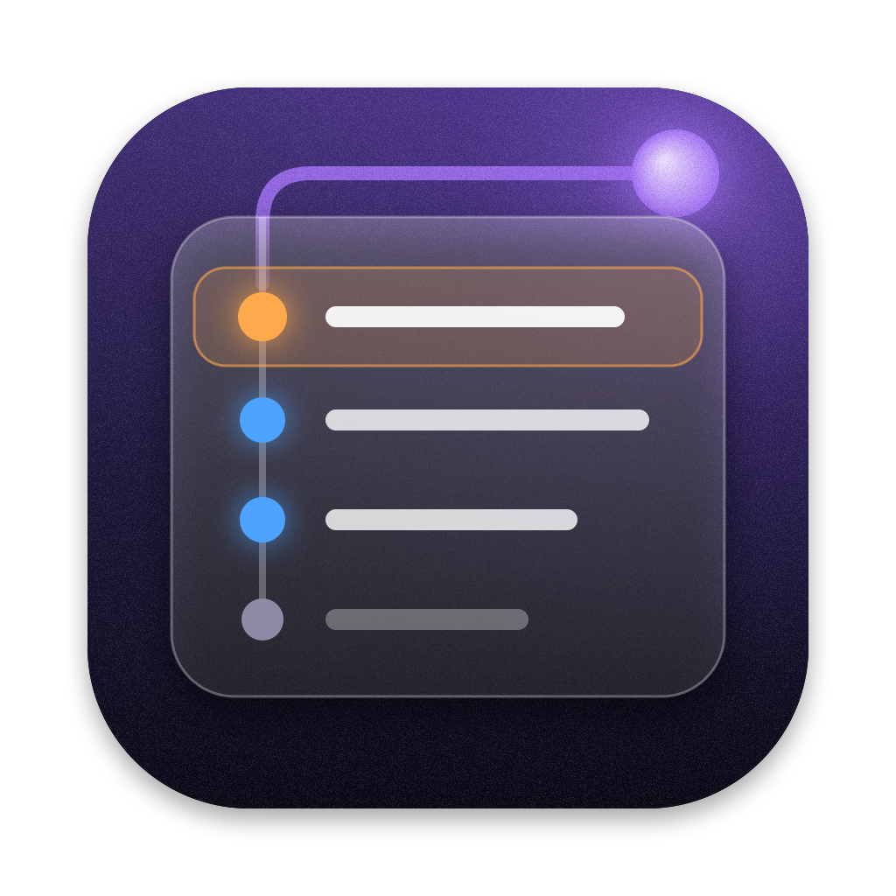

# PRwatch

A floating panel and menu bar count for the pull requests that are waiting on you: yours that have
comments to answer, and the ones you were asked to review, oldest first. It asks GitHub every two
minutes through the `gh` command, so there is no token to set up.

Needs macOS 26, the Swift toolchain (Command Line Tools are enough) and [`gh`](https://cli.github.com)
logged in (`gh auth login`).

```bash
git clone https://github.com/rafaeluna/prwatch.git
cd prwatch
./build.sh install    # builds, copies to ~/Applications, links `prwatch` into ~/.local/bin, launches it
./build.sh            # builds build/PRwatch.app
./build.sh test       # runs the core tests
./build.sh icon       # re-renders the icon from Bundle/make-icon.swift
```

## Using it

- **Panel**: it's sorted by what you can act on, and each group starts with the one that has waited longest.
  - Orange: your pull requests with comments to answer, each comment on its own line.
  - Blue: pull requests you were asked to review, with who asked and how much there is to read.
  - Green: your pull requests that are approved and have nothing left to answer.
  - Faded one-liners at the bottom: your other open pull requests, with why they wait (in review, draft,
    checks failing, conflicts).
- **Click a pull request** to open it on GitHub: the changes for a review, the conversation for yours.
  Click a comment line to land on that comment. Right-click for the other page or to copy the link.
- **Menu bar**: counts what's waiting on you, in orange when one of yours has comments. Click it to show or
  hide the panel, right-click for Refresh, Settings and Quit. `Esc` hides the panel when it's focused.
- **Refresh**: the arrow in the header or `⌘R` asks GitHub now. It also asks when the Mac wakes and when
  you bring the panel back.
- **Dock**: PRwatch is a regular app. `−` in the header or `⌘M` minimizes the panel into the Dock, and
  clicking it there or the app icon brings it back.
- **Drag** the panel by its header or footer, and widen it from the bottom-right corner. It remembers both.
  Its height follows the list.
- **⌃⌥⌘P** shows or hides the panel from anywhere.
- **Settings** (the gear in the header, or right-click the menu bar icon) has the same options as Daylist
  and Agentwatch: Liquid Glass, blur or solid background with darkness, tint and opacity, a separate look
  for when the pointer is elsewhere, texture, monospaced font, text size, the shortcut, launch at login,
  and the menu bar icon. The look starts out matching your Daylist until you change it here.
- **Terminal**: `prwatch` prints the same list, and `prwatch --watch` redraws it every two minutes.

## What counts as waiting on you

| On your pull request | Counts until |
|---|---|
| A review thread whose last comment isn't yours, from a person or a bot | You reply in it or resolve it |
| A comment on the conversation, or a review summary, from a person | You push a commit or comment there |
| A review that requested changes | You push a commit or comment there |

Conversation comments from bots never count, since they have no way to be resolved. An account counts as a
bot when GitHub says it is one or its name ends in `bot`.

A pull request is one to review while GitHub lists you (or a team you're on) as a requested reviewer. Its
age is how long ago you were asked. Once you submit a review GitHub drops the request, so it leaves the
list until someone asks you again.

## Limits

- It reads up to 30 of your open pull requests and 30 review requests, and the newest 50 threads on each.
- It sees what the account `gh` is logged in as can see. Check with `gh auth status`.
- Each check costs about 16 of GitHub's 5,000 hourly GraphQL points, so around a tenth of the budget.
